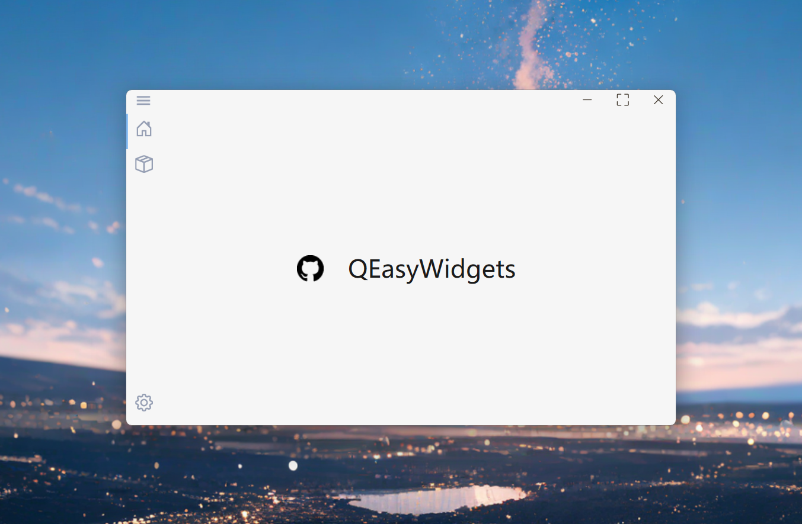

<div align = "center">

# QEasyWidgets

一个现代化 Qt 组件库，提供了增强的组件，支持主题切换、动画效果和简洁的 API。

[](https://pypi.org/project/QEasyWidgets/)&nbsp;



</div>

---

<div align = "center">

**简体中文** | [**English**](../README.md)

</div>


## Python

### 部署

### pip

```shell
pip install QEasyWidgets -i https://pypi.org/simple/
```


## C++

### 要求

- Qt 6.x 或 Qt 5.15+
- 支持 C++17 的编译器
- qmake 或 CMake

### 构建命令

- 使用 CMake
```bash
cd QEasyWidgets
mkdir build && cd build
cmake ..
cmake --build .
```

- 使用 QMake
```bash
cd QEasyWidgets
qmake QEasyWidgets.pro
make          # Linux/macOS
nmake         # Windows (MSVC)
mingw32-make  # Windows (MinGW)
```

### 构建输出

库文件将构建为静态库：
- 调试版: `qeasywidgetsd.lib` (Windows) 或 `libqeasywidgets.a` (Unix)
- 发布版: `qeasywidgets.lib` (Windows) 或 `libqeasywidgets.a` (Unix)

### 使用方法

- 基础示例
```cpp
#include <QApplication>

#include "QEasyWidgets.h"
#include "Components/Button.h"
#include "Windows/Window.h"

int main(int argc, char *argv[]) {
    QApplication app(argc, argv);
    QEWIns.setTheme(LIGHT); // Set Theme
    WindowBase window; // Create a window
    PrimaryButton *button = new PrimaryButton("Click Me", &window); // Create a button
    button->setIcon(IconBase::Play);
    window.setCentralWidget(button);
    window.show();
    return app.exec();
}
```


## 案例
这里有些基于本组件库的项目:
- [Easy Voice Toolkit](https://github.com/Spr-Aachen/Easy-Voice-Toolkit)
- [LLM PromptMaster](https://github.com/Spr-Aachen/LLM-PromptMaster)
- [ParkingLot-Management](https://github.com/Spr-Aachen/ParkingLot-Management)


## 引用
- [Microsoft WinUI-Gallery](https://github.com/microsoft/WinUI-Gallery)
- [PyEasyUtils](https://github.com/Spr-Aachen/PyEasyUtils)